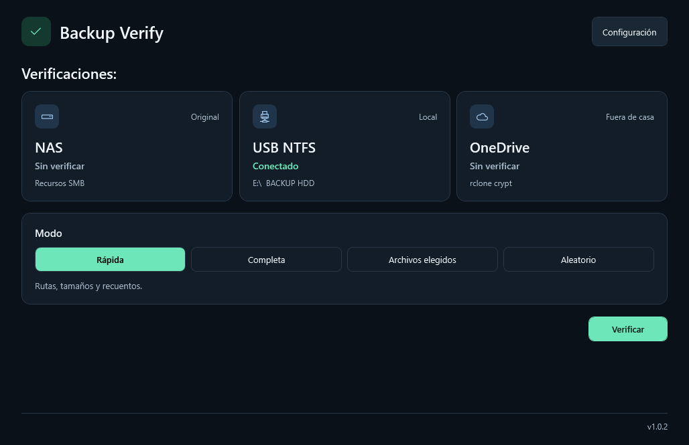

# Backup Verify

Backup Verify es una app portátil para Windows que comprueba tus copias 3‑2‑1. Toma el NAS como referencia y compara sus archivos con los del disco USB y la copia cifrada en OneDrive.

En **Verificaciones**, elige un modo y pulsa **Verificar**. La app usa todos los grupos de carpetas configurados. Las tres tarjetas te muestran el estado de cada origen. Desde **Ver detalle** puedes ver qué archivos faltan, sobran, son distintos o no se pudieron comprobar.

## Modos de verificación

| Modo | Qué hace |
| --- | --- |
| **Rápida** | Compara rutas y tamaños. Cuenta los archivos y las carpetas de cada origen. |
| **Completa** | Comprueba también el contenido de los archivos. Puede tardar más porque lee los archivos del NAS. |
| **Archivos elegidos** | Recupera desde los tres orígenes los archivos que indiques en `config.json` y comprueba que las copias coincidan con el original. |
| **Aleatorio** | Elige un archivo del NAS al azar, te muestra cuál salió e intenta recuperarlo desde el USB y OneDrive para compararlo con el original. |

Las pruebas de recuperación guardan los archivos en `checks/`, junto a la app. Cada versión lleva el sufijo `_nas`, `_usb` o `_cloud` antes de la extensión. La versión de OneDrive se guarda descifrada.

## Primer uso

1. Descarga `BackupVerify.exe` para Windows x64 desde [GitHub Releases](https://github.com/iasdev/backup-verify-desktop/releases/latest) y ábrelo desde una carpeta donde puedas guardar archivos. La app crea `config.json` a su lado la primera vez.
2. Conéctate a las carpetas del NAS desde el Explorador de Windows y conecta el disco de copia a tu PC. En **Configuración**, elige tu disco USB NTFS y pulsa **Guardar**. Si acabas de conectarlo, pulsa **Actualizar**. Usa **Volver**, abajo a la derecha, para regresar a la pantalla principal.
3. En `config.json`, indica dónde están las carpetas del NAS, el USB y OneDrive, y qué archivos quieres usar en **Archivos elegidos**. Para OneDrive, usa tu configuración existente de rclone. Si editas el archivo con la app abierta, pulsa **Recargar**.
